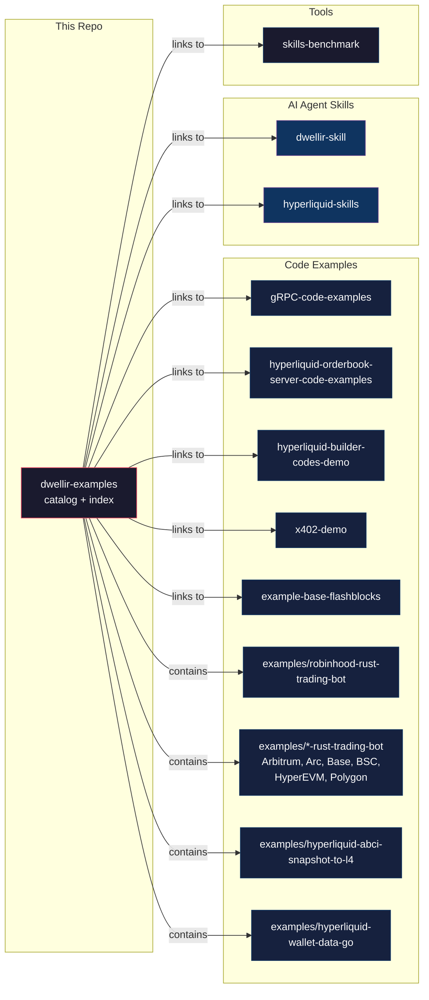

# Dwellir Examples

Curated code examples, demos, and AI agent skills for building on blockchain infrastructure with [Dwellir](https://www.dwellir.com).

> **Start here.** Each project is a self-contained, cloneable repo (or a folder under [`examples/`](./examples)). Pick one, clone it, add your API key, and run.

---

## Code Examples

Production-ready examples showing how to use Dwellir's infrastructure APIs.

| Example | Chain | What you'll learn | Language | Difficulty |
|---------|-------|-------------------|----------|------------|
| [gRPC Code Examples](https://github.com/dwellir-public/gRPC-code-examples) | Multi-chain | Connect to Dwellir's gRPC service, stream blockchain data | Python | Beginner |
| [Hyperliquid Orderbook Examples](https://github.com/dwellir-public/hyperliquid-orderbook-server-code-examples) | Hyperliquid | WebSocket connections, L2/L4 orderbook data, market metrics | Python | Beginner &rarr; Intermediate |
| [Hyperliquid Builder Codes Demo](https://github.com/dwellir-public/hyperliquid-builder-codes-demo) | Hyperliquid | Builder codes &mdash; approve, trade with fees, revoke | TypeScript | Intermediate |
| [x402 Payment Protocol Demo](https://github.com/dwellir-public/x402-demo) | Base | HTTP-native micropayments with USDC, no API keys needed | TypeScript | Beginner |
| [Base Flashblocks Visualizer](https://github.com/dwellir-public/example-base-flashblocks) | Base | Flashblock pre-confirmations vs standard block finality, live visualization | TypeScript | Beginner |
| [Robinhood Chain Rust Trading Bot](./examples/robinhood-rust-trading-bot) | Robinhood Chain | Read a live DEX pool price over JSON-RPC, paper-trade a moving-average crossover | Rust | Beginner |
| [Arbitrum Rust Trading Bot](./examples/arbitrum-rust-trading-bot) | Arbitrum | Read a live DEX pool price over JSON-RPC, paper-trade a moving-average crossover | Rust | Beginner |
| [Arc Rust Trading Bot](./examples/arc-rust-trading-bot) | Arc | Read a live DEX pool price over JSON-RPC, paper-trade a moving-average crossover | Rust | Beginner |
| [Base Rust Trading Bot](./examples/base-rust-trading-bot) | Base | Read a live DEX pool price over JSON-RPC, paper-trade a moving-average crossover | Rust | Beginner |
| [BSC Rust Trading Bot](./examples/bsc-rust-trading-bot) | BSC | Read a live DEX pool price over JSON-RPC, paper-trade a moving-average crossover | Rust | Beginner |
| [Hyperliquid EVM Rust Trading Bot](./examples/hyperliquid-rust-trading-bot) | Hyperliquid EVM | Read a live DEX pool price over JSON-RPC, paper-trade a moving-average crossover | Rust | Beginner |
| [Polygon Rust Trading Bot](./examples/polygon-rust-trading-bot) | Polygon | Read a live DEX pool price over JSON-RPC, paper-trade a moving-average crossover | Rust | Beginner |
| [Hyperliquid ABCI Snapshot to L4](./examples/hyperliquid-abci-snapshot-to-l4) | Hyperliquid | Rebuild the full L4 order book from a `periodic_abci_states` snapshot without hl-node | Python | Intermediate |
| [Hyperliquid Wallet Data in Go](./examples/hyperliquid-wallet-data-go) | Hyperliquid | Stream funding and ledger updates for your wallets over gRPC, page fill history from the Index, read HIP-3 (TradeXYZ) positions and prices, check builder fees and staking | Go | Intermediate |

## AI Agent Skills

Structured knowledge files that give AI coding agents (Claude Code, etc.) deep context about blockchain APIs.

| Skill | Scope | What it enables |
|-------|-------|-----------------|
| [Dwellir Skill](https://github.com/dwellir-public/dwellir-skill) | 140+ chains | EVM, Substrate/Polkadot, non-EVM chains, trace/debug APIs, WebSocket subscriptions |
| [Hyperliquid Skills](https://github.com/dwellir-public/hyperliquid-skills) | Hyperliquid | HyperEVM JSON-RPC, Info API, gRPC streaming, Orderbook WebSocket |

Install a skill in one command:

```bash
npx skills add dwellir-public/dwellir-skill
```

## Developer Tools

| Tool | Purpose | Language |
|------|---------|----------|
| [Skills Benchmark](https://github.com/dwellir-public/skills-benchmark) | Measure how infrastructure skills affect AI coding agent performance | Shell |

---

## How it fits together



## Quick start

Every example repo follows the same pattern:

```bash
# 1. Clone
git clone https://github.com/dwellir-public/<example-name>
cd <example-name>

# 2. Install
npm install   # or pip install -r requirements.txt

# 3. Configure
cp .env.example .env
# Add your Dwellir API key — get one free at https://www.dwellir.com

# 4. Run
npm start     # or python main.py
```

## For agents and automation

This repo includes machine-readable files for programmatic access:

| File | Format | Use case |
|------|--------|----------|
| [`examples.json`](./examples.json) | JSON | Structured manifest &mdash; build galleries, search, filter |
| [`llms.txt`](./llms.txt) | Plain text | LLM/agent-optimized summary of all examples |

## Get an API key

All examples connect to Dwellir's blockchain infrastructure. Sign up for a free API key at [dwellir.com](https://www.dwellir.com).

---

Built by [Dwellir](https://www.dwellir.com) &mdash; blockchain infrastructure for developers and AI agents.
